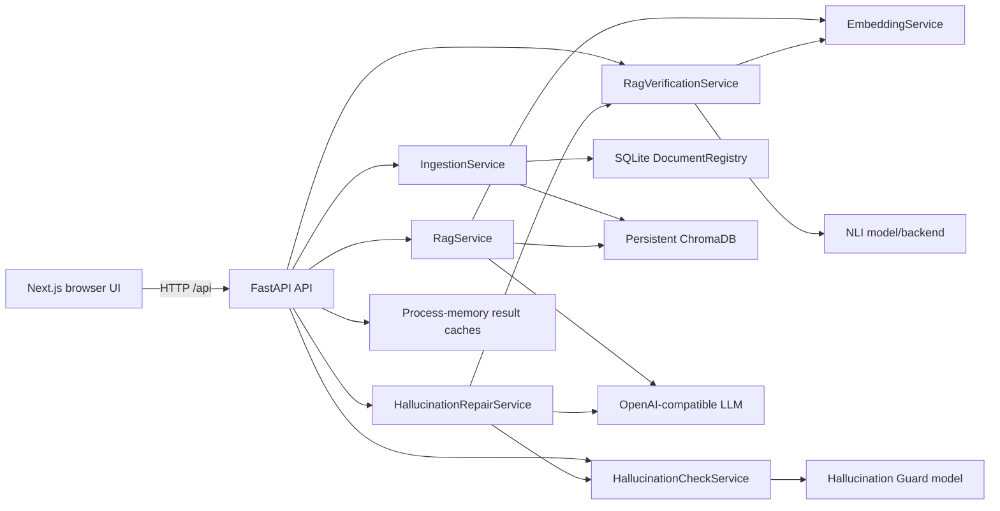
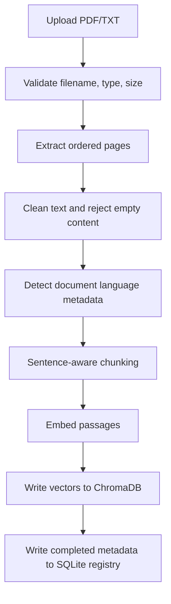
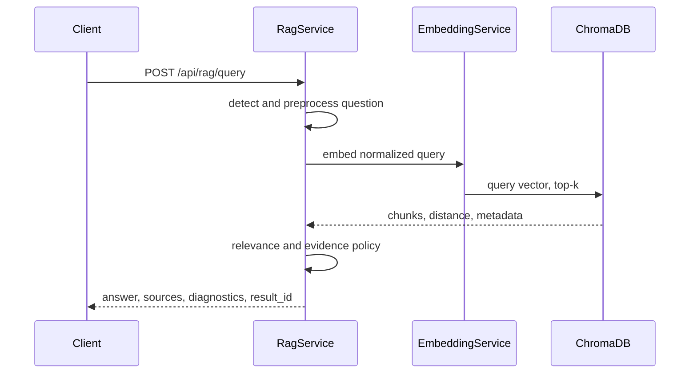
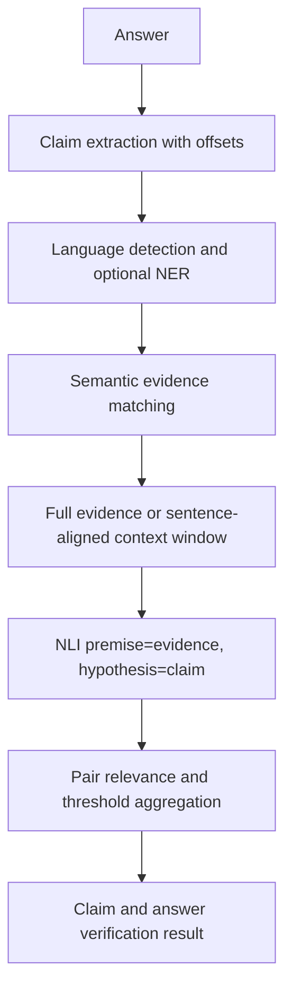
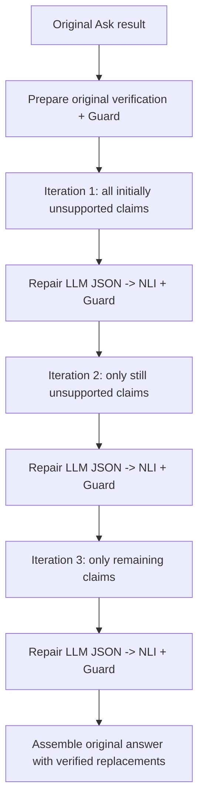

# Multilingual RAG, Hallucination Localization, and Repair Pipeline

> **Implementation-derived documentation.** This document describes the code currently in
> this repository. Values marked **Not configured**, **Not verified**, **Not implemented**,
> or **Experimental** are intentionally not inferred.

## Table of contents

1. [Scope and system boundary](#1-scope-and-system-boundary)
2. [Runtime topology](#2-runtime-topology)
3. [Configuration and active defaults](#3-configuration-and-active-defaults)
4. [Document ingestion](#4-document-ingestion)
5. [Text cleaning and page identity](#5-text-cleaning-and-page-identity)
6. [Chunking](#6-chunking)
7. [Embedding and vector persistence](#7-embedding-and-vector-persistence)
8. [Query language detection](#8-query-language-detection)
9. [Retrieval](#9-retrieval)
10. [Relevance filtering](#10-relevance-filtering)
11. [Evidence sufficiency](#11-evidence-sufficiency)
12. [Answer-generation prompt and LLM](#12-answer-generation-prompt-and-llm)
13. [Ask result contract](#13-ask-result-contract)
14. [Claim extraction](#14-claim-extraction)
15. [Hallucination Guard](#15-hallucination-guard)
16. [NLI verification](#16-nli-verification)
17. [Verification aggregation and statuses](#17-verification-aggregation-and-statuses)
18. [Iterative hallucination repair](#18-iterative-hallucination-repair)
19. [Persistence, identity, and frontend restoration](#19-persistence-identity-and-frontend-restoration)
20. [HTTP API and operational flow](#20-http-api-and-operational-flow)
21. [Limitations, security, and verification notes](#21-limitations-security-and-verification-notes)

## 1. Scope and system boundary

The application is a FastAPI backend and Next.js frontend for:

- PDF/TXT ingestion with page-aware metadata.
- Multilingual embedding and ChromaDB retrieval.
- Evidence-grounded answer generation.
- On-demand claim-level NLI verification.
- An independent Hallucination Guard signal.
- Evidence-grounded, independently re-verified iterative repair.

The answer-generation path does **not** claim that an answer is verified. RAG responses
start with `verification_pending` when an LLM answer exists; verification is an explicit
later operation. The main backend composition is in
[backend/app/main.py](backend/app/main.py), and dependency-singleton wiring is in
[backend/app/api/deps.py](backend/app/api/deps.py).

## 2. Runtime topology

Services are cached with `lru_cache(maxsize=1)`, so the default deployment has one
service instance per backend process. This is important: the vector store and document
registry are persistent, but Ask/check/repair result caches are not durable database
records.

## 3. Configuration and active defaults

Settings are loaded from environment variables and `backend/.env` by
[backend/app/core/config.py](backend/app/core/config.py). The following are the
confirmed defaults in `Settings`:

| Area | Setting | Default |
|---|---|---:|
| Vector store | `CHROMA_PERSIST_DIRECTORY` | `./data/chroma` |
| Vector store | `CHROMA_COLLECTION_NAME` | `rag_documents` |
| Embeddings | `EMBEDDING_MODEL_NAME` | `BAAI/bge-m3` |
| Embeddings | `EMBEDDING_DEVICE` | `auto` |
| Embeddings | `EMBEDDING_MAX_SEQ_LENGTH` | `1024` |
| Chunking | `CHUNK_SIZE` / `CHUNK_OVERLAP` | `700` / `100` tokens |
| Retrieval | `TOP_K` | `5` |
| Retrieval | `RAG_DISTANCE_FILTER_ENABLED` | `true` |
| Retrieval | `RAG_MAX_DISTANCE` | `0.75` cosine distance |
| RAG | `RAG_MAX_QUESTION_LENGTH` | `2000` |
| RAG | `RAG_MIN_EVIDENCE_CHUNKS` | `1` |
| Ask cache | `RAG_RESULT_CACHE_SIZE` / `RAG_RESULT_TTL_SECONDS` | `32` / `3600` |
| NLI | `VERIFICATION_NLI_MODEL_NAME` | `MoritzLaurer/mDeBERTa-v3-base-mnli-xnli` |
| NLI | `VERIFICATION_NLI_BACKEND` | `local` |
| NLI | `VERIFICATION_NLI_MAX_TOKENS` | `256` |
| NLI | entailment / contradiction thresholds | `0.5` / `0.6` |
| NLI | `VERIFICATION_MAX_CLAIMS` | `20` |
| NLI | `VERIFICATION_MAX_NLI_PAIRS` | `250` |
| Claim verification | minimum evidence relevance | `0.5` |
| Hallucination Guard | `HALLUCINATION_MODEL_NAME` | `Horizon-Labs/hallucination-guard-base` |
| Hallucination Guard | support threshold / review margin | `0.5` / `0.05` |
| Hallucination Guard | max claims / evidence per claim | `64` / `5` |
| Repair | `REPAIR_MAX_ATTEMPTS` | exactly `3` |
| Repair | evidence passages per claim | `3` |
| LLM | temperature / output tokens | `0.0` / `800` |

The active LLM provider, model, API key, and base URL are environment-dependent. The
repository contains provider defaults in
[backend/app/services/generator.py](backend/app/services/generator.py), but the selected
provider is **Not verified** without the deployment environment.

## 4. Document ingestion

`POST /api/documents/upload` accepts up to `MAX_FILES_PER_REQUEST` files (default 5)
and applies a default 20 MB per-file limit. Supported formats are PDF and TXT. PDF
pages use one-based page numbers; TXT is represented as one page with no PDF page
number. The orchestrator is
[IngestionService.ingest](backend/app/services/ingestion_service.py) and the extraction
implementation is
[DocumentProcessor.extract](backend/app/services/document_processor.py).

Duplicate content is detected by SHA-256 unless `ALLOW_DUPLICATE_DOCUMENTS=true`.
Individual file failures are returned as structured failed entries; successful files in
the same request are not discarded.

## 5. Text cleaning and page identity

Text is cleaned before chunking using the text-cleaning helpers called by
[IngestionService](backend/app/services/ingestion_service.py). Empty or non-meaningful
pages are excluded from indexing. Page boundaries are retained: the chunker processes
each extracted page independently and does not create a chunk spanning two pages.

PDF image-only OCR is **Not implemented**. A PDF with no sufficient extractable
alphanumeric text is rejected with an image-only-PDF error. Source filename, document
ID, chunk ID, chunk index, and page number are carried into vector metadata and later
API responses.

## 6. Chunking

[TextChunker](backend/app/services/text_chunker.py) splits paragraphs and sentences,
then packs them up to the configured token budget. The default is 700 tokens with a
100-token overlap. Oversized sentences are split on word boundaries. Duplicate
normalized chunk text within a document is skipped. Chunk IDs are stable hashes of the
document ID, index, and chunk text.

The configured tokenizer is the embedding model tokenizer unless
`TOKENIZER_MODEL_NAME` is supplied. The actual tokenizer behavior depends on the
installed Hugging Face model and is therefore runtime-dependent.

## 7. Embedding and vector persistence

[EmbeddingService](backend/app/services/embedding_service.py) lazily loads one
`SentenceTransformer` model per process. It supports `auto`, CPU, CUDA, and MPS device
selection, normalizes embeddings by default, and uses E5 query/passage prefixes only
when the configured model name contains `e5` and prefixes remain `auto`.

[ChromaStore](backend/app/vectorstore/chroma_store.py) uses a persistent Chroma client
with cosine space and no Chroma-managed embedding function. Embeddings are supplied
explicitly. The collection records the embedding model and checks both model identity
and vector dimension before writes or queries.

The document registry is SQLite-backed through
[DocumentRegistry](backend/app/services/document_registry.py). ChromaDB stores chunk
text, vectors, and source metadata; SQLite stores document-level ingestion metadata and
status.

## 8. Query language detection

`QueryLanguageDetector` first attempts Lingua over a curated multilingual language set
and can fall back to `langdetect`. It reports code, confidence, margin reliability,
mixed-script information, method, and reason. Detection is metadata only: it does not
translate the query or prove model quality in that language.

Minimum query length, confidence, margin, and fallback language are configurable through
`QUERY_LANGUAGE_*` settings. Document language detection is separate and conservative;
it uses the full cleaned document subject to a 6,000-character detector input slice.
That slice is for language identification metadata, not evidence supplied to repair.

## 9. Retrieval

[RetrievalService.search](backend/app/services/retrieval_service.py) embeds the
normalized question with the same model used for passages and requests at most 50
results. Chroma's distance is cosine distance; lower is more similar. Retrieval scores
are explicitly not probabilities or factual confidence.

The optional `document_ids` request field restricts the search to selected documents.
The RAG response retains the retrieved source text and source references needed by
verification and repair.

## 10. Relevance filtering

[filter_relevant_chunks](backend/app/services/relevance_filter.py) sorts candidates by
normalized distance and, by default, keeps only chunks with distance `<= 0.75`.
Invalid scores are rejected. Disabling the filter bypasses the absolute gate but still
normalizes and ranks scores; this switch is intended for controlled experiments or
backward compatibility.

The response distinguishes candidate chunks, kept chunks, rejected chunks, metric,
threshold, and rejection reasons. A kept chunk is a retrieval candidate, not proof of
claim truth.

## 11. Evidence sufficiency

Evidence sufficiency is a separate decision layer after retrieval filtering. The
configured mode is `auto`, with `llm` and `heuristic` alternatives. The assessor can
return:

- `sufficient_evidence`
- `partial_evidence`
- `insufficient_evidence`
- `irrelevant_evidence`

The default assessment budget is eight chunks and 12,000 characters. The LLM judge and
lexical fallback are implemented in
[backend/app/services/evidence_assessor.py](backend/app/services/evidence_assessor.py).
The lexical sufficient and partial coverage defaults are `0.6` and `0.35`.

Generation is skipped when policy says evidence is insufficient or irrelevant unless
`RAG_GENERATION_WITHOUT_EVIDENCE=true`. System abstention messages are localized for
English, Hindi, and Tamil; other languages are **Not configured** in the abstention
message map.

## 12. Answer-generation prompt and LLM

[PromptBuilder](backend/app/services/prompt_builder.py) emits system and user messages
with a versioned prompt (`rag-evidence-grounded-answer-2.2.0`). Evidence is delimited
as untrusted data. The prompt requires source identifiers beside factual statements,
forbids invented details and citations, instructs same-language answering where
possible, and requires flat bullet structure for factual assertions.

The generation adapter is OpenAI-compatible and supports Groq, OpenAI, OpenRouter,
Together, Ollama, and custom-compatible endpoints by configuration. Credentials remain
backend-only. Default temperature is zero. The actual remote model is environment
dependent and **Not verified** from source alone.

## 13. Ask result contract

`RagQueryResponse` is defined in
[backend/app/schemas/rag.py](backend/app/schemas/rag.py). It contains:

- opaque `result_id`;
- original and normalized questions;
- detected language metadata;
- answer, answer mode, answer status, and evidence state;
- source text plus document/page/chunk references;
- retrieval, assessment, verification, generation, diagnostic, and timing objects.

An LLM-generated answer is initially `verification_pending`. The answer endpoint does
not run claim-level NLI. `POST /api/verification/results/{result_id}` later applies
verification to the exact stored answer and sources, without retrieval or generation.

## 14. Claim extraction

The local claim extractor in
[backend/app/services/verification/claims.py](backend/app/services/verification/claims.py)
preserves character offsets, sentence spans, headings/list structure, citations,
language metadata, completeness, evaluability, and extraction warnings. It supports
multilingual text, including dedicated Hindi handling. The hard extraction ceiling is
30 claims; the default number evaluated is 20. Claims beyond configured evaluation
limits remain represented as unchecked rather than silently disappearing.

Claims that are headings, citation-only fragments, incomplete lead-ins, metadata
commentary, or otherwise not independently factual can be marked unevaluable. The
response reports skipped fragments and location status.

## 15. Hallucination Guard

The dedicated Guard is configured by `HALLUCINATION_MODEL_NAME` and runs independently
from NLI. [HallucinationCheckService](backend/app/services/hallucination_service.py)
extracts evaluable claims, pairs them with claim-specific retrieved evidence, invokes
the detector, and selects the best support probability per claim.

The default support threshold is `0.5`; the review margin is `0.05`. Guard outputs
are `supported` or `potentially_hallucinated`, with raw model label, support
probability, explanation, evidence references, and optional NLI comparison fields.
Guard evidence is capped at five passages per claim and 500 total pairs by default.
The initial Guard path has a separate `HALLUCINATION_MAX_EVIDENCE_CHARS=4000` safety
setting in the current implementation; this is distinct from the removed
repair-specific 6,000-character truncation.

The prior skipped-heading/incomplete-fragment warning is no longer generated or shown
by the current Hallucination Checks and Repair UI.

## 16. NLI verification

The default local NLI model is
`MoritzLaurer/mDeBERTa-v3-base-mnli-xnli`. Supported backends are local Transformers,
ONNX, and an HTTPS Hugging Face endpoint. ONNX requires a configured model path;
hosted mode requires an HTTPS endpoint and API key.

The NLI implementation in
[backend/app/services/verification/nli.py](backend/app/services/verification/nli.py)
counts pair tokens and creates sentence-aware focused windows when full evidence
cannot fit the model's pair budget. The configured maximum is 256 pair tokens,
subject to the loaded model's actual limit. NLI predictions are model scores, not
calibrated factual probabilities.

Semantic claim-to-evidence matching uses the embedding service and falls back to
deterministic lexical overlap if semantic matching fails. Optional NER uses
`Davlan/xlm-roberta-base-wikiann-ner` and is metadata/enrichment, not a truth
decision.

## 17. Verification aggregation and statuses

Each claim/evidence comparison records evidence identity, source/page, similarity,
relevance, term coverage, premise strategy, token counts, windows, NLI label,
confidence, probabilities, errors, and whether it counts toward the verdict.

The configured NLI thresholds are entailment `>= 0.5` and contradiction `>= 0.6`.
Relevance must also satisfy the configured minimum before a raw NLI result contributes.
The engine exhaustively plans available claim/evidence pairs up to the
`VERIFICATION_MAX_NLI_PAIRS` ceiling, reports missing pairs, and retries transient
NLI engine failures according to the configured retry count.

Answer status mapping is implemented by
[answer_status_after_verification](backend/app/services/rag_verification_service.py):

| Condition | Status |
|---|---|
| Any contradicted claim | `contradicted` |
| Every claim supported and complete | `grounded` |
| Some supported claims or incomplete claims | `partially_grounded` |
| No usable support / all unevaluable | `insufficient_evidence` |
| Verification not run or unavailable | existing pending/error state is preserved |

## 18. Iterative hallucination repair

Repair is intentionally separate from original Ask and original verification.
[HallucinationRepairService](backend/app/services/hallucination_repair_service.py)
reuses the stored Ask result, original source passages, Guard findings, and NLI
engine. It never reruns retrieval or regenerates the entire answer.

The maximum is a literal type/configuration value of exactly three. The request schema
also accepts only `Literal[3]`, so callers cannot increase the limit.

The repair prompt receives claim-specific selected Guard-supported evidence with source,
page, chunk, and quote references. The repair-specific 6,000-character slice and
configuration were removed. The current repair selector keeps the complete selected
evidence text; when NLI re-verification needs a smaller model input, the existing
sentence-aligned NLI windowing is used. It does not retrieve another Chroma result set.

Every proposed repair is accepted only when both the existing NLI and Hallucination
Guard return their supported verdicts. A disagreement remains unresolved and follows
the retry policy. Repair model output is strict JSON with `REPAIRED`, `QUALIFIED`,
`REMOVED`, or `INSUFFICIENT_EVIDENCE` decisions.

Final composition is offset-based against the original answer:

- originally supported claims remain in their original text and position;
- successfully verified replacements replace only their corresponding original span;
- unresolved claims remain visible with an unresolved/potentially-hallucinated label;
- insufficient-evidence claims remain visible with an uncertainty label;
- headings, order, citations, and non-claim text are preserved wherever offsets allow.

`RepairResult` contains original answer, original verification, Guard response, every
claim row, each actual attempt, iteration records, final claim spans, final answer,
status, warnings, and fixed `max_attempts: 3`.

## 19. Persistence, identity, and frontend restoration

The persistence boundary is deliberately split:

| Data | Current storage | Identity |
|---|---|---|
| Document metadata | SQLite `DocumentRegistry` | `document_id` |
| Chunks/vectors/source metadata | Persistent ChromaDB | `chunk_id` / `document_id` |
| Ask answer and evidence | process-memory `RagResultStore`, TTL/size bounded | `result_id` |
| Hallucination Check | process-memory `HallucinationCheckService` cache | Ask `result_id` |
| Repair preparation/result | process-memory repair caches, TTL/size bounded | Ask `result_id` |
| Latest browser selection | browser `sessionStorage` stores only ID | `rag.latestResultId` |

The browser does not store document content. `WorkspaceProvider` restores the latest
ID from `sessionStorage`, calls `GET /api/rag/results/{result_id}`, and exposes the
full result to mounted pages. A genuinely new Ask clears the previous latest ID before
starting, receives a new result ID, and therefore cannot mix old verification with a
new answer.

Hallucination Checks restores through `GET /api/hallucination/results/{result_id}`,
which reads the cache without rerunning Guard or NLI. Repair restores through
`GET /api/repair/source/{result_id}` and `GET /api/repair/results/{result_id}`.
The original verification and repair verification are separate objects; repair does
not overwrite the original Ask result.

Because result caches are process-memory only, a backend restart, eviction, or TTL
expiry makes these results unavailable. Cross-process/shared durable result storage
is **Not implemented**.

## 20. HTTP API and operational flow

| Method | Route | Purpose |
|---|---|---|
| `GET` | `/api/health` | Component health |
| `POST` | `/api/documents/upload` | Ingest PDF/TXT files |
| `GET` | `/api/documents` | List document registry entries |
| `GET` | `/api/documents/{document_id}` | Get document metadata |
| `DELETE` | `/api/documents/{document_id}` | Delete document and chunks |
| `POST` | `/api/retrieval/search` | Retrieval-only search |
| `POST` | `/api/rag/query` | Generate and cache an Ask result |
| `GET` | `/api/rag/results/{result_id}` | Restore Ask result without generation |
| `POST` | `/api/verification/check` | Verify an arbitrary answer/evidence payload |
| `POST` | `/api/verification/results/{result_id}` | Verify a stored Ask result |
| `POST` | `/api/hallucination/check` | Run or return cached Guard result |
| `GET` | `/api/hallucination/results/{result_id}` | Restore cached Guard result |
| `GET` | `/api/repair/source/{result_id}` | Prepare original/check/repair context |
| `POST` | `/api/repair/run` | Run fixed three-iteration repair |
| `GET` | `/api/repair/results/{result_id}` | Restore cached repair |

Frontend wrappers live in
[frontend/lib/api.ts](frontend/lib/api.ts). The shared provider and page components
are under [frontend/components/](frontend/components/). The root layout mounts
[WorkspaceProvider](frontend/components/WorkspaceProvider.tsx) above page navigation,
so page unmounts do not clear the latest Ask selection.

## 21. Limitations, security, and verification notes

### Confirmed limitations

- Ask, Hallucination Check, and Repair result records are short-lived process-memory
  caches, not durable database rows.
- Cache eviction and backend restart invalidate result IDs.
- OCR for image-only PDFs is not implemented.
- The LLM provider/model is deployment configuration and cannot be established from
  repository defaults alone.
- Language detection is metadata and does not translate or guarantee multilingual
  model accuracy.
- Retrieval similarity, NLI confidence, and Guard support probability are model or
  distance signals, not calibrated truth probabilities.
- Verification is capped by configured claim and pair budgets; skipped or unevaluated
  work is reported in response fields.
- Initial Hallucination Guard input has a configured 4,000-character safety ceiling.
  Repair-specific arbitrary 6,000-character truncation is not present.

### Security and data handling

- LLM and hosted-NLI credentials are read from backend settings and are not returned
  to the frontend.
- Retrieved evidence is delimited and treated as untrusted data in generation prompts.
- Hosted NLI configuration requires an HTTPS endpoint.
- Browser `sessionStorage` holds only an opaque latest-result identifier, not document
  content.
- Upload filenames are reduced to display-safe basenames before registry use.

### Source map

| Concern | Primary source |
|---|---|
| Settings and validation | [backend/app/core/config.py](backend/app/core/config.py) |
| App/router composition | [backend/app/main.py](backend/app/main.py) |
| Dependency singletons | [backend/app/api/deps.py](backend/app/api/deps.py) |
| Upload/extraction | [backend/app/api/documents.py](backend/app/api/documents.py), [backend/app/services/document_processor.py](backend/app/services/document_processor.py) |
| Ingestion | [backend/app/services/ingestion_service.py](backend/app/services/ingestion_service.py) |
| Chunking | [backend/app/services/text_chunker.py](backend/app/services/text_chunker.py) |
| Embeddings/vector store | [backend/app/services/embedding_service.py](backend/app/services/embedding_service.py), [backend/app/vectorstore/chroma_store.py](backend/app/vectorstore/chroma_store.py) |
| RAG orchestration | [backend/app/services/rag_service.py](backend/app/services/rag_service.py) |
| Prompt/generation | [backend/app/services/prompt_builder.py](backend/app/services/prompt_builder.py), [backend/app/services/generator.py](backend/app/services/generator.py) |
| Verification | [backend/app/services/verification/engine.py](backend/app/services/verification/engine.py) |
| NLI/matching/NER | [backend/app/services/verification/nli.py](backend/app/services/verification/nli.py), [backend/app/services/verification/matching.py](backend/app/services/verification/matching.py), [backend/app/services/verification/ner.py](backend/app/services/verification/ner.py) |
| Hallucination Guard | [backend/app/services/hallucination_service.py](backend/app/services/hallucination_service.py) |
| Repair | [backend/app/services/hallucination_repair_service.py](backend/app/services/hallucination_repair_service.py), [backend/app/services/repair_prompt.py](backend/app/services/repair_prompt.py) |
| Result identity/cache | [backend/app/services/rag_result_store.py](backend/app/services/rag_result_store.py) |
| API contracts | [backend/app/schemas/rag.py](backend/app/schemas/rag.py), [backend/app/schemas/verification.py](backend/app/schemas/verification.py), [backend/app/schemas/hallucination.py](backend/app/schemas/hallucination.py), [backend/app/schemas/repair.py](backend/app/schemas/repair.py) |
| Frontend restoration | [frontend/components/WorkspaceProvider.tsx](frontend/components/WorkspaceProvider.tsx), [frontend/lib/api.ts](frontend/lib/api.ts) |

### Documentation validation

This file is documentation-only. No application code, configuration, CSS, database
records, prompts, or unrelated functionality was changed. The documented behavior was
checked against the source files listed above; runtime model availability and deployed
environment overrides remain deployment-specific.

## Models used and why

| Model or backend | Configuration / default | Used for | Why it is used |
|---|---|---|---|
| BAAI BGE-M3 | `EMBEDDING_MODEL_NAME=BAAI/bge-m3` | Passage and query embeddings | Provides multilingual vector representations so document chunks and user questions can be compared in the same vector space for retrieval and semantic claim-to-evidence matching. |
| MoritzLaurer mDeBERTa-v3-base MNLI/XNLI | `VERIFICATION_NLI_MODEL_NAME=MoritzLaurer/mDeBERTa-v3-base-mnli-xnli` | Natural-language inference | Classifies each claim/evidence pair as entailment, contradiction, or neutral to independently verify claims and repaired claims. |
| Horizon Labs Hallucination Guard Base | `HALLUCINATION_MODEL_NAME=Horizon-Labs/hallucination-guard-base` | Claim-level groundedness detection | Supplies an independent support signal for each claim. Repair accepts a replacement only when this signal and NLI both support it. |
| Davlan XLM-RoBERTa WikiANN NER | `VERIFICATION_NER_MODEL_NAME=Davlan/xlm-roberta-base-wikiann-ner` | Named-entity recognition | Identifies people, organizations, locations, and other named entities in claims so entity-sensitive claims can be enriched and localized during verification. |
| Lingua | Primary query-language backend when installed | Query language detection | Detects the likely language and confidence of multilingual questions without translating or rewriting them. |
| langdetect | Fallback language backend | Query/document language detection fallback | Provides a fallback when the primary Lingua backend is unavailable. |
| Hugging Face tokenizer for the embedding model | `TOKENIZER_MODEL_NAME` or the embedding model | Chunk and embedding token counts | Keeps chunk sizing and embedding input limits aligned with the active embedding model tokenizer. |
| Hugging Face tokenizer for the NLI model | Loaded with the active NLI model | NLI pair token counting and context windows | Ensures evidence/claim pairs fit the actual NLI model token budget and enables sentence-aligned evidence windows when needed. |
| OpenAI-compatible chat-completion model | `LLM_PROVIDER`, `LLM_MODEL`, `LLM_BASE_URL` | Answer generation, evidence assessment, and repair proposal generation | Generates answers from retrieved evidence and produces structured repair proposals. The concrete deployed model is environment-dependent; no single active model can be confirmed from repository source alone. |
| Mock generator | `LLM_PROVIDER=mock` or test configuration | Tests and offline development | Provides deterministic, network-free responses so prompt construction, API behavior, verification orchestration, and repair logic can be tested reproducibly. |

The models above serve different purposes and are intentionally not treated as
interchangeable. Embeddings rank semantic similarity, NLI evaluates textual
entailment/contradiction, and Hallucination Guard provides a separate groundedness
signal. None of their scores is a calibrated probability that a claim is true.
